# Chief of Staff

**A chief of staff for your coding projects.** It sits next to [Claude Code](https://code.claude.com/docs) and turns "I want this done" into a supervised pipeline: a worker writes the spec, you decide; a worker plans it, an independent validator checks the plan; a worker implements it in its own git worktree, an independent reviewer re-runs the tests; and you merge. Nothing is ever pushed for you.

<p align="center">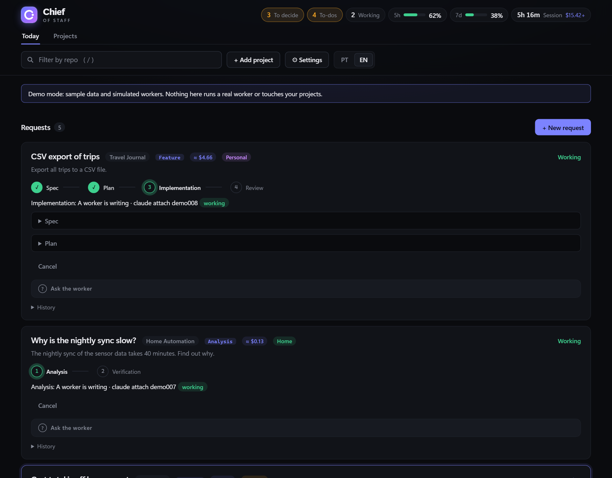</p>

- **A dashboard** (127.0.0.1 only) that shows just what needs a decision from you.
- **A supervised pipeline** for features, bug fixes, maintenance and read-only analyses, with your approval at every gate.
- **Independent checks built in**: plans are validated and implementations are reviewed *and re-tested* by workers that never saw the author's context.
- **Session to-dos**: what you left unfinished in your Claude Code sessions, ready to resume or turn into a request.
- **Work sessions with their time and AI cost**: start and end a session, see how long it was and what the workers cost, per model and per project (an estimate, labelled as one).
- **An optional knowledge vault** (Obsidian-style markdown) that workers write to and an automatic curator keeps tidy, with every change revertible.
- **Your data stays yours and separate** from the application, so you can update or experiment with the code while you keep using it.

Everything is Python's standard library: there is nothing to `pip install`.

---

## Quick start

```bash
git clone <repository-url> chief-of-staff && cd chief-of-staff
python scripts/chief.py doctor        # checks what is installed and tells you what is missing
python app/server.py                  # then open http://127.0.0.1:8780
```

(Use `python3` where `python` is not Python 3.) The first start creates your data folder. Open **⚙ Settings** and point the Chief at the folder where your projects live; every sub-folder becomes a project. You do not need a notes vault to start: it is [optional](#the-vault-optional).

**Just want to look around?** Start it on sample data. Nothing real is read or launched, and the sample folder is deleted when you stop it:

```bash
python app/server.py --demo           # http://127.0.0.1:8790
```

### Requirements

| Needed | For | Notes |
|---|---|---|
| **Python 3.10+** | everything | standard library only |
| **[Claude Code](https://code.claude.com/docs)** (`claude`) | the workers | must support background sessions (`claude --bg`); tested with 2.1.319. Sign in first. |
| **git** | worktrees, commits, cloning | |
| GitHub CLI (`gh`) | optional | cloning private repos, showing which account is logged in |
| Node.js 22+ | optional | only for the dashboard tests and for regenerating the screenshots |
| pytest | optional | only to run the tests |

`python scripts/chief.py doctor` checks all of this and prints an install link for anything missing. It was built and tested on **Windows 11**; macOS and Linux should work, with one known gap: the **Resume** button on a session to-do opens a new console window only on Windows.

### Which model does it use?

**Whatever your Claude Code is set up to use.** The Chief never calls a model API itself: every worker is a `claude --bg` session. So the model and the provider are decided where you configure Claude Code: its own login, [Amazon Bedrock](https://code.claude.com/docs/en/amazon-bedrock), [Google Vertex AI](https://code.claude.com/docs/en/google-vertex-ai), or any [LLM gateway](https://code.claude.com/docs/en/llm-gateway-connect) that speaks the format Claude Code expects, with the model picked as described in [model configuration](https://code.claude.com/docs/en/model-config).

In the dashboard, **Default** leaves the choice to Claude Code; the menu next to it lists the names in `models` in your `projects.json` (default `opus`, `sonnet`, `haiku`), and any name Claude Code accepts works there, for example `"models": ["my-gateway/some-model"]`.

The cost estimates know the published prices of the Claude models; for any other model give a price under `prices`.

One honest caveat: the pipeline relies on workers following long, structured prompts (verdict headings, a JSON file of questions, exact test counts) and it checks what they write. It has only been exercised with Claude models. A weaker model may produce reports the Chief cannot read; the pipeline then repeats the step a couple of times and hands the decision back to you rather than guessing.

---

## A tour of the dashboard

Two tabs sit at the top: **Today** (everything below, the things that need you) and **Projects** (what each project looks like right now).

**Requests** move through the pipeline; the page only shows what needs you. A worker writes a spec and leaves its open questions; the Chief turns them into a form with a recommended option for each:

<p align="center">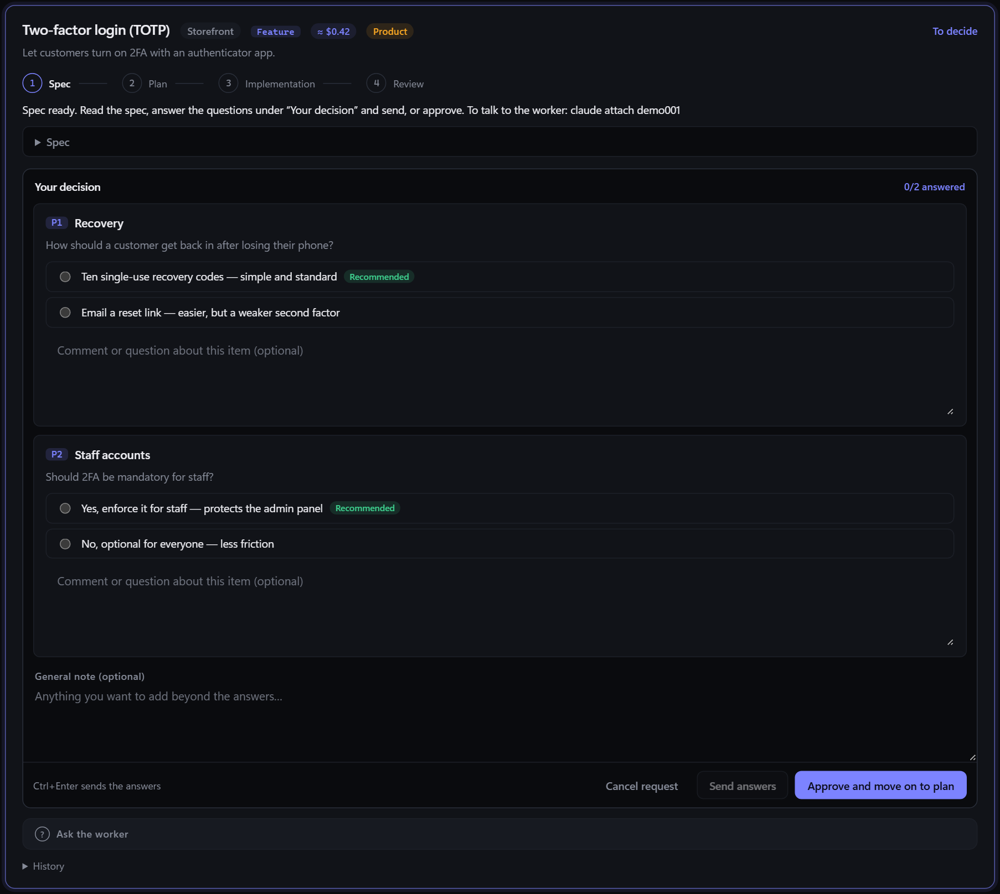</p>

Before you see a **plan**, an independent validator (fresh context, read-only) checks it against the spec and the real repository. Its findings arrive with the plan, and for each one you choose **Fix** or **Accept**:

<p align="center">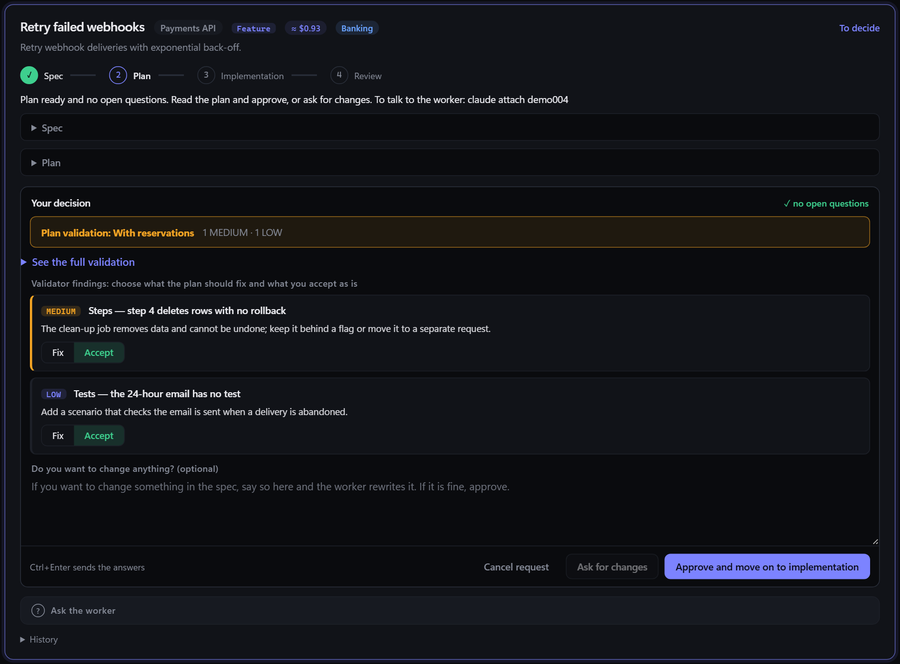</p>

After the implementation, a **reviewer** who did not write it reads the diff and **re-runs the whole test suite itself**. The Chief compares the reviewer's numbers with the implementer's baseline and final results, and only commits (locally, in the request's own worktree) when they agree:

<p align="center">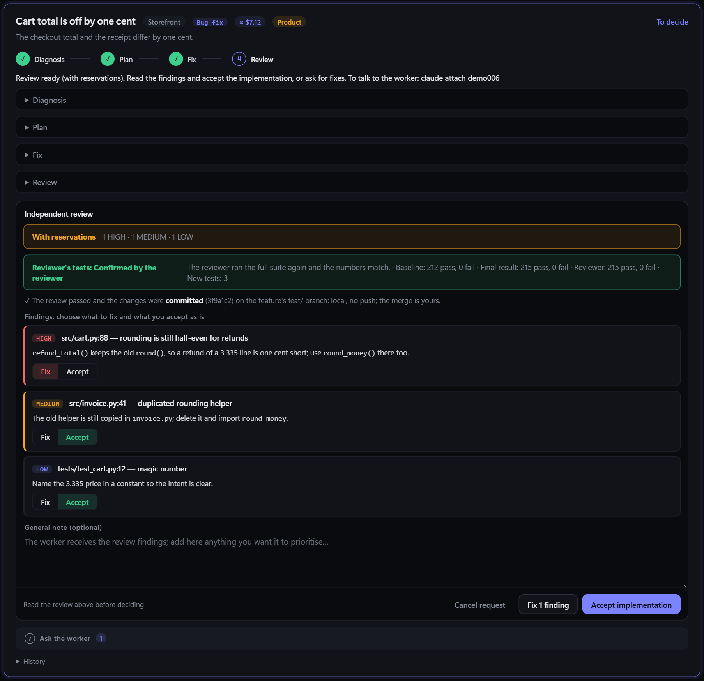</p>

Requests that are being worked on show who is working and how to attach to the session:

<p align="center">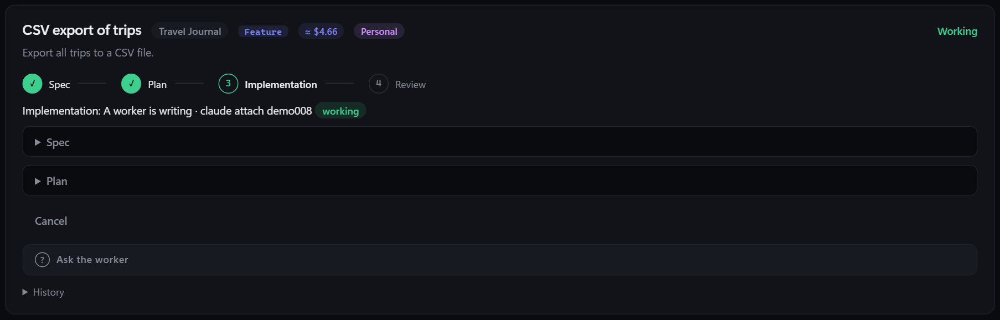</p>

**Session to-dos** collect what you left unfinished in your Claude Code sessions. Resume it, turn it into a request, or dismiss it. **Workers** lists the sessions the Chief started: the ones still running, and, in its history, the ones that finished during the current work session:

<p align="center">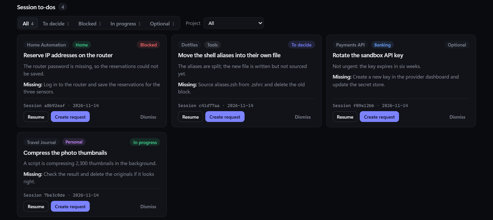</p>
<p align="center">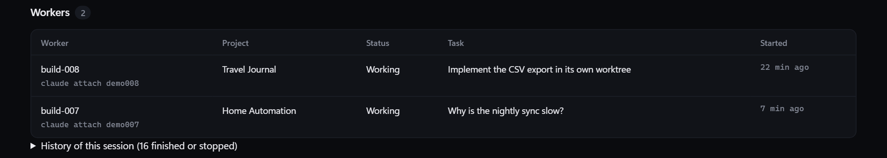</p>

Every card shows its own estimated cost in a small pill next to its title. The pill in the header is your **work session**: how long you have been working (active time, not the time of day) and what the AI has cost so far. Click it for the breakdown by model and by project, the past sessions, and to **end the session**:

<p align="center">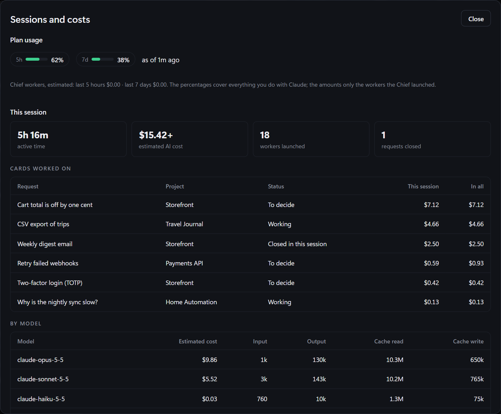&nbsp;&nbsp;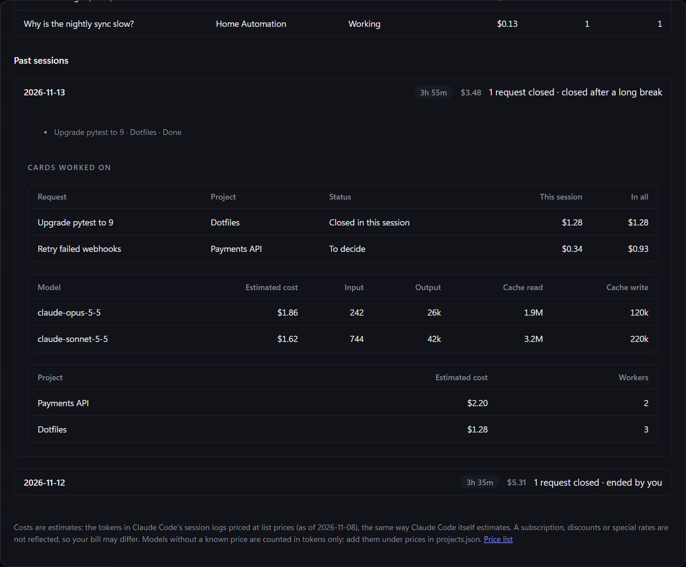</p>

You start a request from **+ New request**, choosing its kind (feature, bug fix, maintenance, analysis, **publish** or **production release**), the project and, if you want, the model. Tick **Run until the review** to skip the approval clicks that carry no risk: the Chief then approves the spec and the plan by itself when the worker left no questions and the validator did not block the plan. Accepting the implementation is always your click, and publish and release requests never run this way. **⚙ Settings** manages your project folders, each project's category, the vault and the hosts the Chief may clone from:

**Publish (commit, push, pull request).** A *publish* request has two phases. The first prepares the commit **locally** in the project's repo (only the files you named, on a new branch if needed) and writes a report with the branch, the remote, the commits, the proposed PR text and the exact commands it would run. Nothing is pushed. Only when you click **Approve and publish** does the second phase run those commands (`git push -u <remote> <branch>` and, if asked, `gh pr create`): never a force-push, never another branch or remote, never a login, never a merge.

**Production release.** A *release* request has three phases: a read-only worker writes the release plan (the exact commit, the regression tests, the promotion steps, the post-checks and the rollback); an **independent** worker, who did not write the plan, runs the regression tests locally on that commit and returns a **POSITIVE or NEGATIVE** verdict with evidence; and only after a POSITIVE verdict for the planned commit and your click does a worker carry out exactly the plan's steps. With a negative or unreadable verdict the promotion cannot be approved: you can run the tests again or cancel. The promotion worker never rolls back by itself.

**Workers can suggest requests.** A worker that finds follow-up work (for example a commit after an analysis) can suggest a request. The suggestion appears under **Suggested by workers** with the worker's name; nothing starts until you click **Review and create** and confirm the pre-filled dialog. Each worker can have at most 5 open suggestions, and anything that looks like a credential is removed from them.

<p align="center">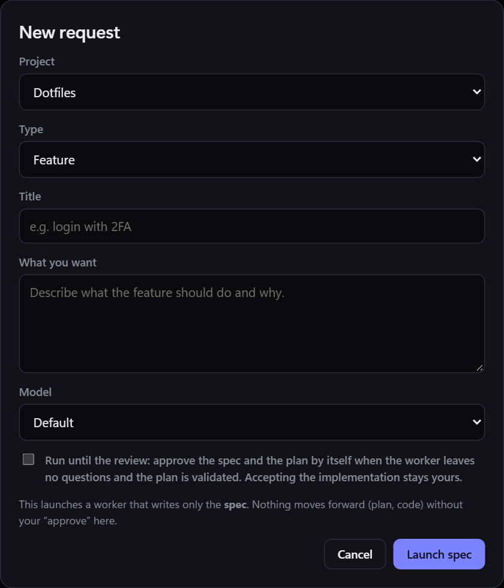&nbsp;&nbsp;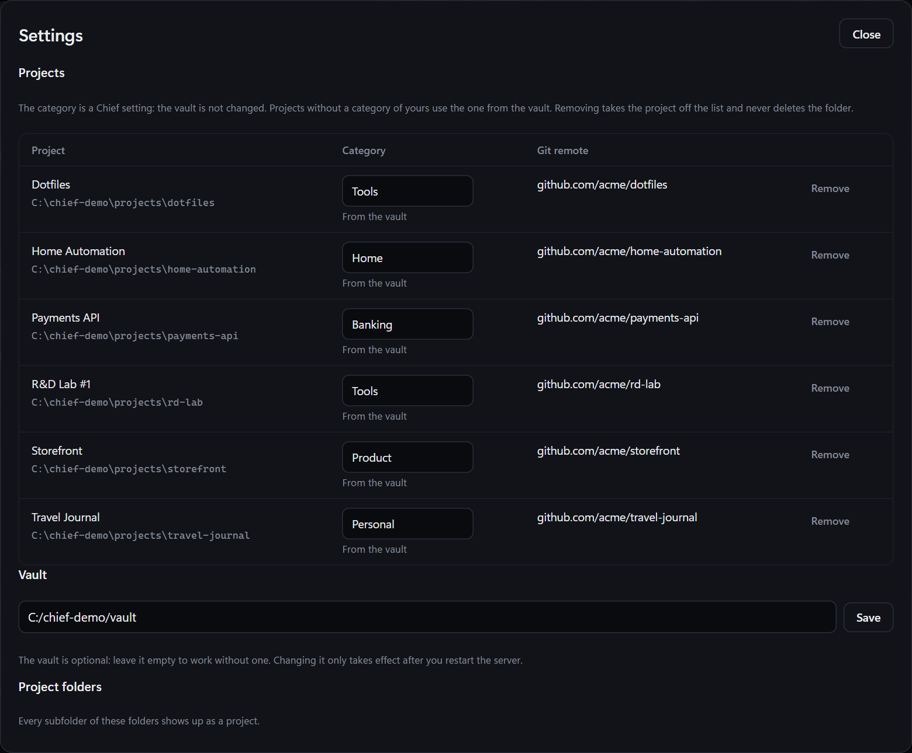</p>

**Projects** lists every project with its category, branch and uncommitted changes, open requests, fixes waiting, and estimated cost. Sort by **Needs attention** (the default) or **Name**, and the search box filters by name. Click one to open its page: a header with a one-sentence description, the branch, changes and last commit, then **Needs attention** (review findings and blocked to-dos, each review finding with a **Create fix request** button that opens the new-request dialog as a bug fix with the finding filled in), its **requests**, an **overview and architecture** (from the vault note or the README), its **documents** (README, `CLAUDE.md`, `ARCHITECTURE.md`, `docs/specs|plans|analyses`, opened in a dialog), its **tools** (commands and the names of the Claude Code skills, agents and MCP servers it configures), **costs**, and its **workers and to-dos**. Each block says where its data came from and disappears when it has nothing to show. Project names elsewhere in the dashboard link to the page.

<p align="center">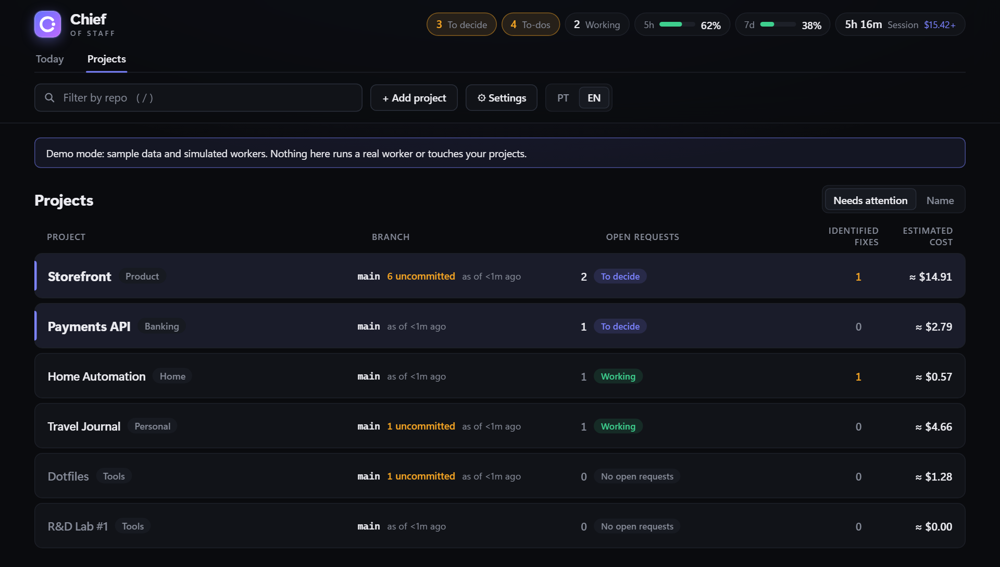</p>
<p align="center">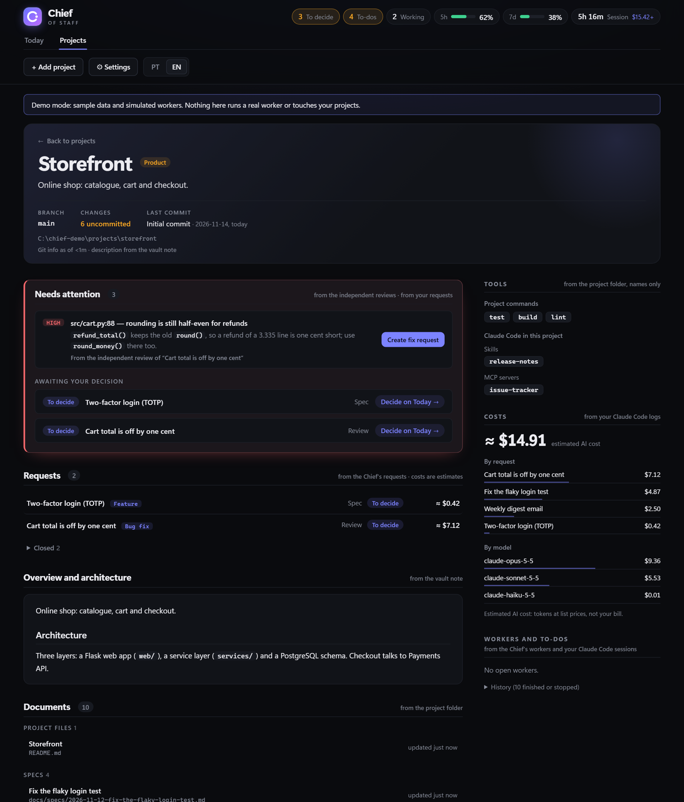</p>

**Alerts.** When a worker has been stuck on a permission prompt or a question for three minutes, or a request's worker stopped without its result, a banner at the top says which one and what it is waiting for. The same line is printed once in the server's terminal, so you see it with the dashboard closed.

(Every image here comes from `--demo`; see [Regenerating the screenshots](#regenerating-the-screenshots).)

---

## Architecture

<p align="center">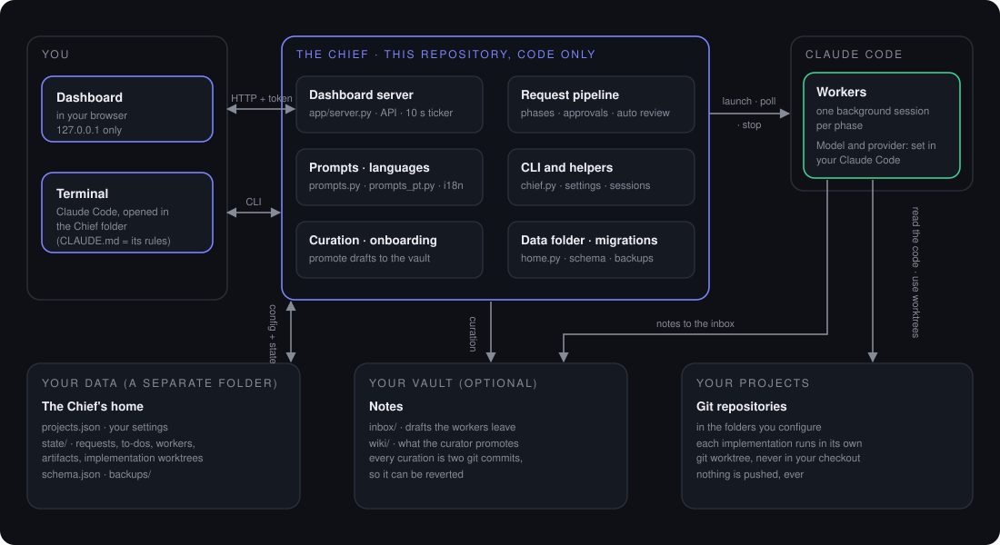</p>

The Chief is a small local web server plus a set of scripts. It does not run models; it **launches, supervises and checks Claude Code sessions**.

| Part | Files | What it does |
|---|---|---|
| Dashboard server | `app/server.py`, `app/index.html` | The page and its JSON API (the project pages use `GET /api/projects`, `GET /api/project?name=` and `GET /api/project/doc?name=&path=`, all token-protected). Reads are GET; every write needs the per-start token, the dashboard's own `Origin` and a small JSON body. A 10-second ticker moves requests forward even with the page closed. |
| Request pipeline | `scripts/features.py`, `prompts*.py` | The state machine: phases, approvals, automatic review and fix rounds, the test gate, archiving of approved specs and plans. The prompts for each phase and kind live in `prompts.py` (English) and `prompts_pt.py` (Portuguese). |
| CLI and helpers | `scripts/chief.py`, `settings.py`, `sessions.py`, `pending.py` | Project registry, `status`, `dispatch`, `doctor`; reading your Claude Code sessions; the to-do cards; the Settings actions. |
| Project pages | `scripts/projectview.py`, `projectpage.py` | What the Projects tab shows: the sandboxed, redacted reading of a project's documents and tools, its fixes, and the list and detail data. |
| Curation and onboarding | `scripts/curation.py`, `onboarding.py` | Promotes the drafts workers leave in the vault inbox; studies a newly added project and writes its first note. |
| Work sessions and costs | `scripts/worksession.py`, `usage.py`, `report.py` | Sessions (start, end, active time), what each worker cost (read from Claude Code's logs), and the report. |
| Data folder | `scripts/home.py`, `migrations.py` | Where your data lives, the schema version, backups and migrations. |
| Demo | `scripts/demo.py` | Sample data and a simulated Claude Code for `--demo`. |

**What a worker is.** Each phase of each request is one `claude --bg` session started in the project's folder with a prompt the Chief wrote. The Chief polls `claude agents --json` to see whether it is still working, reads the artifact it wrote (`spec.md`, `plan.md`, `report.md`, `review.md`, `questions.json`), and stops the session when it is no longer needed. Workers run with `--permission-mode auto`, and their instructions forbid pushing, deleting what they did not create, and touching secrets.

---

## How a request works

<p align="center">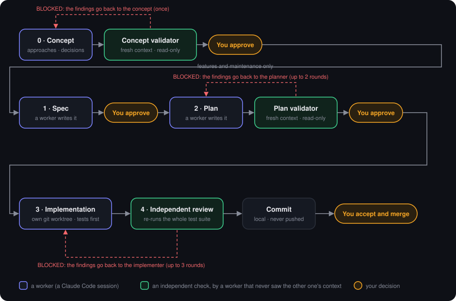</p>

1. **Spec.** A worker reads the code and your request and writes the spec, with its doubts as questions that have options and a recommendation. You answer them in the page and approve, or ask for changes (the same phase runs again with your comment).
2. **Plan.** A worker writes the plan, tests first. **Before you see it**, an independent validator checks coverage of the spec, that the files and commands it names exist, the order of the steps, scope and the tests section. If it finds a critical or high problem, the findings go back to the planner automatically, once; minor findings do not send the plan back, they arrive with it for you to fix or accept.
3. **Implementation**, in its own `git worktree` (branch `feat/<id>`, kept in your data folder, never in your checkout). The worker runs the project's **whole** test suite *before* touching anything (the baseline), writes tests first, runs it again at the end, and leaves the work **uncommitted**.
4. **Review.** A fresh worker reads the uncommitted diff, runs the tests and the linter, and checks each acceptance criterion. If it **blocks**, the findings go back to the implementer (up to 3 rounds). The Chief refuses to commit unless the reviewer's own test numbers match the implementer's. Only then is the work committed, locally. You accept it and **the merge is yours**.

Workers write for a small card: every artifact is bullets only, 80 lines at most, with the sections the Chief reads kept as they are. Long material (command output, step-by-step detail for the next worker) goes to a `<artifact>-details.md` file next to it, which the card does not show.

Every report must say what was actually executed and verified (`EXECUTED AND VERIFIED`, `PARTIALLY EXECUTED` or `NOT EXECUTED`); a report that ran nothing cannot be approved.

| Kind | Phases | Notes |
|---|---|---|
| **Feature** | spec → plan → implementation → review | |
| **Bug fix** | diagnosis → plan → fix → review | The plan's first step is a test that reproduces the bug and fails; the reviewer checks it. |
| **Maintenance** | plan → execution → review | Behaviour must not change: the suite stays equal to the baseline. No spec. |
| **Analysis** | read-only report → independent verification | No worktree, no commit. The approved report is archived in the project's `docs/analyses/` and in the vault. |

Approved specs and plans are also copied into the project (`docs/specs/`, `docs/plans/`), uncommitted and never overwriting anything.

Every card, of any kind and in any phase, has an **Ask the worker** box. A question launches a read-only worker that reads the request's documents and the work and answers right under the card, with evidence. It never changes the request or moves it to the next phase: approving, asking for changes and cancelling stay on the card's own buttons. Its cost counts towards the request.

---

## Work sessions and costs

A **work session** is the span of time you spend working with the Chief. The dashboard opens one when it starts; you close it with **End session** (it also closes by itself after a break of 12 hours or more, so an overnight gap does not become "one long session"). It gives the history a boundary:

- **Done** and the **workers' history** show only what happened in the current session. Open requests carry over; finished ones move to *Past sessions*, one click away.
- The session records its **active time**: how long the dashboard server was running while the session was open, never the hours it was off. The dashboard shows how long ago things happened, not clock times.
- It records the **AI cost** of the workers launched in it, with the model shown next to every figure, and keeps it **per project** as well.

**The cost of a card is separate from the cost of a session.** A request runs many workers: the spec, the plan, its validation, the implementation, the review and every fix round. Each worker is tagged with its request and phase when it is launched, so the card shows **what the whole request has cost** (hover it for the share of each phase and how many workers each took), and that total keeps adding up even when the request stretches over several work sessions. Ending a session never changes what a card has cost, and a card stays open from one session to the next until it is finished or cancelled: that is the only thing that moves it to *Done*, and it then shows there only in the session that closed it. Each session's detail lists the **cards it worked on** (finished or not) with what each cost *in that session* and *in all so far*, so a day spent on analysis and specs is accounted for even if no card was closed that day. The dialog also has a **By request** table. Work that belongs to no request (adding a project, the vault curation, a worker you launched by hand) counts toward the session and the project, but not toward any card. Workers from older versions are attributed to their request from the id in their task text.

**How the cost is measured.** Claude Code writes every session's conversation, with the model and the token counts of each message, to `~/.claude/projects/`. It records no dollar amount for background sessions (neither `claude agents` nor the logs carry one), so the Chief does what Claude Code's own `/usage` does: tokens × **list price**, per model, counting input, output, 5-minute and 1-hour cache writes and cache reads, plus the higher Haiku 5.5 price for long prompts, fast mode and US-only inference. The figures are saved per worker (so they survive Claude Code deleting old logs) and frozen into the session's record when it ends.

It is an **estimate**, not a bill:

- It uses Anthropic's published prices (the date is shown in the dashboard). A subscription, discounts, batch or contracted rates are not reflected.
- It counts the workers the Chief launches, not your own Claude Code conversations.
- A model without a price (a gateway or local model) is counted in tokens and marked **no price**, never as free. Give it one in `projects.json`:

```json
"prices": {
  "my-gateway/some-model": {"input": 1.0, "output": 4.0, "cache_write_5m": 1.25, "cache_write_1h": 2.0, "cache_read": 0.1}
}
```

(USD per million tokens. The key is the exact model name Claude Code logs, or a family such as `sonnet-5-5`.)

From the command line: `python scripts/chief.py costs [--project NAME] [--json]` (per session, project, model and request) and `python scripts/chief.py session [end]`.

---

## Plan usage and usage limits

If you use a Claude subscription (Pro, Max, Ultra), it has a **5-hour** and a **7-day** allowance, shared by everything you do with Claude. The dashboard header shows both as percentages next to the session pill (green below 70 %, amber from 70 %, red from 90 %); the «Sessions and costs» dialog adds when each resets and what the Chief's own workers are estimated to have cost over the same spans.

- **Where the numbers come from.** Claude Code hands them (`rate_limits`) only to a *status line* command, and nowhere else a script may read. So you opt in once, with the **Connect to Claude Code** button in ⚙ Settings → *Plan usage and limits* (it keeps any status line you already have and leaves a backup of `settings.json`), or by hand: `python scripts/chief.py plan` prints the snippet for `~/.claude/settings.json` (the Chief never edits that file, never reads your credentials and never calls Anthropic for this). If you already have a status line, add `--then "<your command>"` and it still runs first. The numbers refresh while an interactive Claude Code session is open; the dashboard says how old they are. Without a subscription, or before the first response, nothing is shown.
- **What happens to a worker that hits a limit.** Claude Code writes a notice in its session log. The Chief reads it, shows a banner («worker paused by a usage limit, continues in …») and a note on the card. If Claude Code continues by itself, nothing else happens. Otherwise, once the limit has reset (plus a short grace period) the Chief restarts the interrupted phase, at most 3 times per request, and logs it in the card's history. Turn that off with the switch in ⚙ Settings → *Plan usage and limits* (`resume_after_limit` in `projects.json`). A request waiting for your decision is never touched.
- The percentages cover all your Claude use; the dollar amounts only the workers the Chief launched.

## Your data is separate from the application

This repository is the application: code only. Everything that is yours lives in the Chief's **home**, outside the repository:

| | |
|---|---|
| Windows | `%APPDATA%\Chief` |
| macOS | `~/Library/Application Support/Chief` |
| Linux | `$XDG_DATA_HOME/chief` or `~/.local/share/chief` |
| anywhere | set `CHIEF_HOME`, or start the server with `--home <folder>` |

`python scripts/chief.py home` shows where everything is. The home holds `projects.json` (your settings), `state/` (requests, to-dos, workers, work sessions, costs, artifacts and the implementations' git worktrees), `schema.json` and `backups/`.

That separation is what lets you **evolve the application while you use it**:

- Update, switch branches in, or re-clone the application without touching your data.
- Try a change on a throw-away copy while the real instance keeps running: `python app/server.py --home /tmp/chief-dev --port 8791`.
- Your data carries a schema version. When a newer version needs a different format it **backs your data up** to `backups/` and **migrates it at start-up** (`scripts/migrations.py`). If the data is newer than the code understands, it refuses to start instead of damaging it.
- Data left inside the repository by an older version is imported on first start (git worktrees included) and the old files are renamed `*.migrated`.

---

## The vault (optional)

**You do not need one.** Leave `vault` empty (the default) and the Chief works the same, minus the notes: workers get no note instructions and no extra folder, nothing is written anywhere but the request's own artifacts and your project's `docs/`, there is no curation, and adding a project does not start the first-note extraction. Turn it on or off whenever you like in **⚙ Settings** (an empty path turns it off; restart to apply).

If you keep notes in an Obsidian-style folder, point `vault` at it. Workers leave a note in its `inbox/` when they finish; when the inbox has been quiet for 10 minutes the curator makes a **checkpoint commit**, promotes the drafts into `wiki/` and your project notes, and makes a **second commit** with only what it changed, so `git revert` undoes it. It never deletes a draft it is unsure about (it moves it to a review folder), omits secrets, and marks what it could not confirm. Outside that curation, the Chief never edits an existing note. If a usage limit interrupts the curation it is paused, not failed: the dashboard says when it continues, and it does not count towards the failures that stop the automation.

The folder and key names follow `vault_language` (`en` by default, or `pt`):

| | `en` | `pt` |
|---|---|---|
| project hubs | `Projects/`, `Areas/` | `Projetos/`, `Areas/` |
| category key | `domain:` | `dominio:` |
| inbox rules file | `README.md` | `LEIA-ME.md` |

---

## Configuration

`projects.json` in your data folder; everything but `models` and `sensitive_paths` can also be edited in **⚙ Settings**.

| Key | Meaning |
|---|---|
| `vault` | Path of your knowledge vault. **Empty = no vault**, which is fine. Changing it needs a restart. |
| `vault_language` | `en` (default) or `pt`: the vault's conventions and the language of the notes workers write there. |
| `roots` | Folders whose sub-folders are all projects. New clones go into the first one. |
| `extras` | Individual project folders outside the roots. |
| `ignore` | Sub-folder names of the roots to skip. |
| `domains` | Per-project category (colours and filters in the dashboard). |
| `hide_domains` | Categories to hide from the dashboard and from workers. |
| `models` | Names offered in the model menu. Any name Claude Code accepts. |
| `phase_models`, `phase_efforts` | Optional model and effort per phase (`spec`, `plan`, `plan-validation`, `build`, `review`, `qa`), e.g. `{"plan": "opus", "review": "sonnet"}` and `{"qa": "low"}`. A phase listed here outranks the request's model; `""` follows it. Questions to the worker use Sonnet unless set. The «By phase» table in the costs dialog shows what each phase costs. |
| `phase_tools` | Permission rules handed to the worker of a phase that must run git commands a background worker cannot ask about, keyed `<kind>:<stage>`: `{"ship:review": {"allow": ["Bash(git push -u:*)"], "deny": ["Bash(git push*--force*)"]}}`. By default only the *Publish* request has rules (commit in its first phase; push and `gh pr create` in its second, after you approve, with force, delete and merge denied). An empty entry switches a default off. Your Claude Code settings are never changed. |
| `prices` | Your own prices per model, in USD per million tokens, for the cost estimates. Overrides the built-in list (see [Work sessions and costs](#work-sessions-and-costs)). |
| `resume_after_limit` | `true` (default): restart a phase a usage limit interrupted, once the limit has reset. See [Plan usage and usage limits](#plan-usage-and-usage-limits). |
| `clone_hosts` | Hosts "clone a repo" may use (default GitHub, GitLab, Bitbucket, Codeberg). |
| `sensitive_paths` | Name fragments of folders that must never be added as projects. `.ssh`, `.aws`, `.gnupg` and `.kube` are always refused. |
| `dashboard_port` | Port of the dashboard (default 8780). |

## Safety

- The dashboard listens on `127.0.0.1` only. Every call carries the per-start token in a header; writes also need the dashboard's own `Origin` and a small JSON body.
- The Chief never pushes and never changes a remote. Commits happen only in a request's own worktree, and only after an independent review passed.
- "Do not push" is a rule, not only a sentence in the prompt: every worker is launched with deny rules for `git push`, forced or deleting pushes, remote changes, `gh pr merge` and `gh auth`. Only the publication phase of a publish request, after your click, is allowed its one `git push -u`. Configuration cannot remove these rules.
- The pipeline's commit refuses files that look like secrets (`.env*`, private keys, `credentials.json`, `secrets.json`): nothing is committed and the card names the files.
- Workers are told not to delete what they did not create, not to touch secrets (`.env*`, keys, tokens) and not to run irreversible or production actions; those are written as steps for you instead.
- The Chief never reads or stores credentials and never logs in to GitHub for you; cloning uses the login your git already has.
- The project pages read only files inside the project's folder, and only the documents the Chief lists (README, `CLAUDE.md`, `ARCHITECTURE.md`, `docs/specs|plans|analyses`). `.env*`, keys, tokens, secrets files, `settings.local.json` and `CLAUDE.local.md` are never read, and links that leave the project folder are refused. Text is redacted (secrets, private IP addresses, e-mails) before it leaves the server; the Tools block shows names only, never values. Vault `[[wikilinks]]` render as plain text, or as a link when they name a project.
- Session to-dos are read from your Claude Code sessions with secrets, e-mails and private IP addresses stripped.
- Costs are computed locally from your own session logs; nothing about them is sent anywhere.

## Languages

English is the source language of the code, the prompts and the dashboard; Portuguese is an optional translation (the **PT / EN** switch). A request remembers the language it was created in, and its workers write their artifacts in it. To add a language: a `prompts_<lang>.py`, a dictionary in `scripts/i18n.py` and one in `app/index.html`.

---

## Development

```bash
python -m pytest tests                  # a few minutes (it starts real demo servers); runs against a throw-away data folder
```

The tests never read or write your real data: `tests/conftest.py` points the Chief at a temporary folder before anything is imported.

### Regenerating the screenshots

The images in `docs/img/` are produced from the demo, so they never contain anyone's real projects:

```bash
node docs/capture_screenshots.mjs       # needs Node 22+ and Chrome, Chromium or Edge (set CHROME_PATH if it is not found)
```

It starts its own demo server and a headless browser, takes the pictures, and cleans up after itself. The two diagrams are plain SVG files (`docs/img/architecture.svg`, `pipeline.svg`).

### Repository layout

```
app/            the dashboard: server.py (HTTP + API) and index.html (the whole UI)
scripts/        the Chief itself: chief.py (CLI), features.py (pipeline), prompts*.py, curation.py, ...
docs/           capture_screenshots.mjs and docs/img/
tests/          pytest suite
CLAUDE.md       the instructions Claude Code follows when you open it in this folder
```

## License

[MIT](LICENSE).
